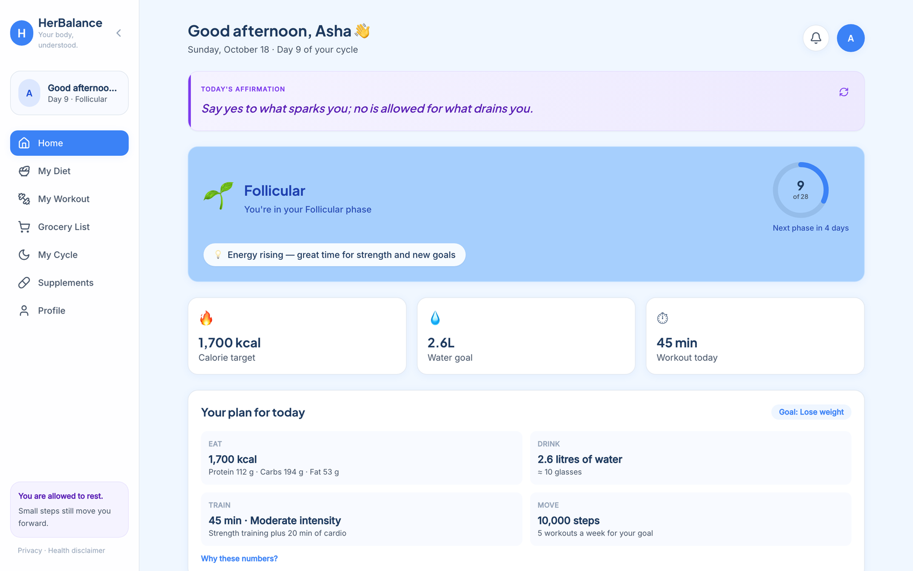
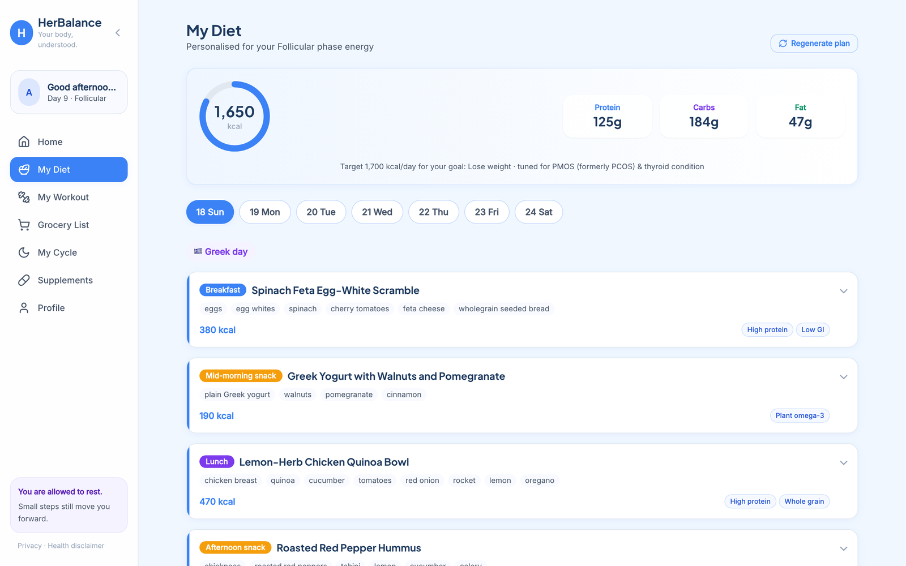
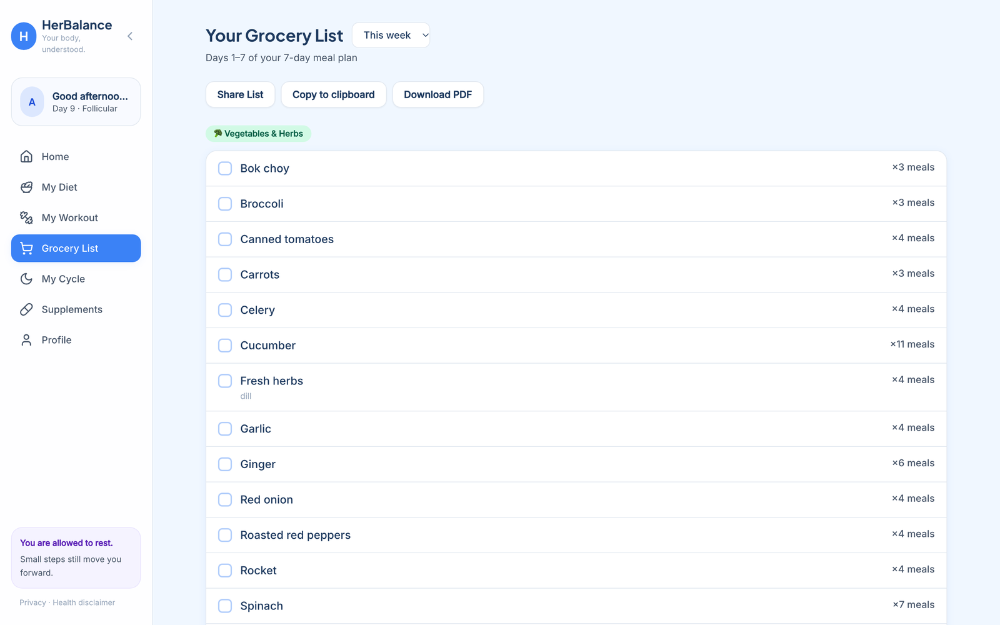
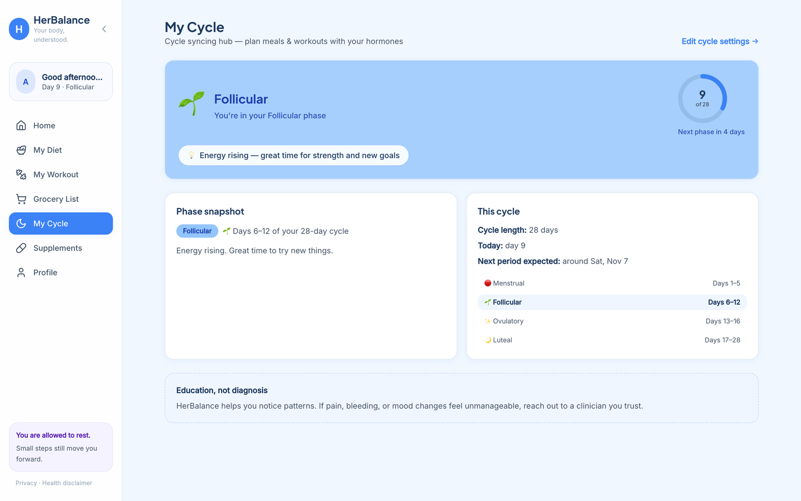

<p align="center">
  
</p>

<h1 align="center">HerBalance</h1>

<p align="center">
  <strong>Meals, workouts and daily targets synced to your menstrual cycle and your goal.</strong><br />
  Built for women managing PCOS/PMOS, thyroid conditions and other hormonal health.
</p>

<p align="center">
  <a href="https://herbalance-five.vercel.app"><strong>Live app → herbalance-five.vercel.app</strong></a>
</p>



## What it does

HerBalance asks for your goal, your cycle and your health profile once, then turns them into a daily plan that changes with your cycle phase.

- **Goal-based targets.** Pick one of 8 goals (lose weight, gain weight, build strength, get fit, manage symptoms, boost energy, cycle regularity, fertility). Calories (Mifflin-St Jeor × activity × goal), protein/carbs/fat, water, steps and workout minutes are calculated from it, with an explanation of every number.
- **Cycle syncing.** Phases come from your last period and cycle length (ovulation ≈ 14 days before the next period), so a 21-, 28- or 35-day cycle each get their own ranges. Intensity drops on menstrual and late-luteal days and peaks around ovulation.
- **AI meal plans.** A 7- or 14-day plan, 5 meals a day, written by Claude for your phase, conditions, diet type, allergies, cuisines and calorie/macro targets.
- **Smart grocery list.** Built from the plan, sorted by aisle, with similar items merged (one real week went from 141 rows to 95). Copy, share, or download as a PDF checklist.
- **Workouts and supplements.** Phase- and goal-aware workout suggestions from a built-in exercise library, plus educational supplement cards for your conditions.
- **Accounts that follow you.** Email sign-up with confirmation, password reset, data synced across devices, kg/cm or lb/ft, and self-serve account deletion.

| Personalised meal plan | Grocery list from the plan | Cycle phases and next period |
| --- | --- | --- |
|  |  |  |

## Tech stack

| Layer | Technology |
| --- | --- |
| Front end | React 18, TypeScript, Vite 5, Tailwind CSS 3, React Router 7, lucide-react |
| Server | Two Vercel serverless functions (`api/diet-plan.ts`, `api/delete-account.ts`) |
| Auth and database | Supabase (Auth + Postgres with row-level security) |
| AI | Claude Opus 5.5 via the Anthropic TypeScript SDK: streaming, structured JSON output, server-side refusal fallback |
| PDF | jsPDF, lazy-loaded only when the user downloads |
| Hosting | Vercel, deployed on every push to `main`, with CSP and other security headers |

## Architecture

```
 Browser (React app) ──── sign-in, profile, workout logs ────▶ Supabase (Auth + Postgres, RLS)
   │                                                             ▲
   │ meal-plan request + login token                             │ verify user, weekly limit, save plan
   ▼                                                             │
 Vercel function: /api/diet-plan ─── prompt ──▶ Claude Opus 5.5  │
 Vercel function: /api/delete-account ───────────────────────────┘ (admin delete, data cascades)
```

- **Secrets stay on the server.** The Anthropic key and the Supabase secret key exist only in Vercel's environment; the browser holds just the public Supabase key.
- **Row-level security.** Every table only lets a signed-in user read and write rows with her own user ID.
- **Safe AI endpoint.** The prompt is built server-side from validated, length-capped fields, so the endpoint can't be used as an open Claude proxy. Each user gets 3 plans per rolling week (configurable).
- **Fast reads.** Pages read a local copy of the user's data, which is pulled from Supabase on sign-in and pushed back on each save.

Key files: [`src/lib/targets.ts`](src/lib/targets.ts) (goal × cycle targets), [`src/types/cycle.ts`](src/types/cycle.ts) (phase model), [`src/lib/groceryList.ts`](src/lib/groceryList.ts) (grocery merging), [`api/diet-plan.ts`](api/diet-plan.ts) and [`api/_lib/dietPrompt.ts`](api/_lib/dietPrompt.ts) (AI meal plans), [`supabase/schema.sql`](supabase/schema.sql) (database).

## Run it locally

Requires Node.js 20 or newer.

```bash
git clone https://github.com/HarikaPunati/herbalance.git
cd herbalance
npm install
cp .env.example .env   # then fill in the keys you have
npm run dev            # http://localhost:5173
```

The app runs **without any keys** in a device-only mode (no login, data in the browser). Add keys to unlock more:

| Variable | Unlocks | Where to get it |
| --- | --- | --- |
| `ANTHROPIC_API_KEY` | AI meal plans | Claude Console → API Keys (a workspace key) |
| `VITE_SUPABASE_URL`, `VITE_SUPABASE_ANON_KEY` | Accounts and cloud sync | Supabase → Project Settings → API |
| `SUPABASE_SECRET_KEY` | Account deletion | Supabase → Project Settings → API Keys (secret) |
| `DIET_PLANS_PER_WEEK` | Change the weekly plan limit (default 3) | Optional |

To set up Supabase, run [`supabase/schema.sql`](supabase/schema.sql) once in the SQL Editor. Branded auth emails are in [`supabase/email-templates/`](supabase/email-templates/).

Other scripts: `npm run build` (type-check and production build), `npm run preview` (serve the build with production security headers), `npm run lint`.

## Health disclaimer

HerBalance offers general wellness guidance, not medical advice, diagnosis or treatment. Targets are estimates, cycle phases are not a fertility tracker or contraception, and AI-generated meal plans can contain mistakes, so always check ingredients against your allergies. Talk to a doctor before changing your diet, exercise or supplements, especially if you are pregnant, take medication, or have a history of disordered eating. See the full [Health Disclaimer](https://herbalance-five.vercel.app/disclaimer) and [Privacy Policy](https://herbalance-five.vercel.app/privacy).

## What I learned

- **Shipping is its own skill.** Going from a polished local prototype to a live multi-user app meant hosting, environment variables, auth email delivery, API billing and debugging production-only failures from server logs.
- **Security has to be designed in.** Keeping API keys server-side, row-level security in the database, and a prompt the client can't rewrite were each deliberate decisions, not defaults.
- **One source of truth beats three.** The app once had three slightly different cycle-phase formulas that disagreed between pages; consolidating them into one tested function fixed a whole class of bugs.
- **Real data finds real problems.** Testing the grocery merger on an actual AI-generated week (265 ingredients) surfaced mis-filed items that sample data never would.
- **AI-assisted development still needs verification.** The app was built with Claude Code as a pair programmer; every change was type-checked, tested in the browser and checked on the live site before it counted as done.
